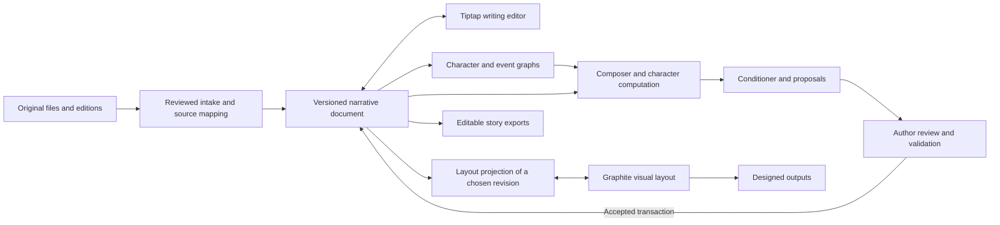

# Editable document engine and graphic layout plan

Status: **partially implemented and under qualification**, November 1, 2026. A first local Tiptap editing surface and its rich sidecar are integrated with the existing graph and proposal paths; see [document engine status](DOCUMENT_ENGINE_STATUS.md) for exact behavior and limits. The complete document contract, Graphite layout integration and wider qualification below remain open.

## Decision

Select **Tiptap's open-source core on ProseMirror** as the document editor, subject to the qualification gates below, with a custom narrative schema and the project's own local revision/proposal store. Investigate **GraphiteEditor/Graphite** as a separately qualified visual-layout surface for illustrated pages and graphic assets. Retain the existing Python graph, composition, conditioning, and validation services behind an explicit document API.

The user asked to pick the best engine after investigating Graphite Docs. Tiptap is the research recommendation because its schema, transactions and extensions fit addressable story blocks and reviewable edits without adopting an older full productivity suite. Lexical is the fallback if a focused Tiptap spike fails the contracts below. This decision does not establish that any library preserves this project's files or that Graphite can yet perform the intended round trip; both require the gates below.

The two Graphite projects are distinct:

- [Graphite Docs](https://github.com/Graphite-Docs/graphite) was a Google Docs alternative. Its creator says the [hosted product has ended](https://www.graphitedocs.com/); the public repository remains available. Its published [dependency manifest](https://raw.githubusercontent.com/Graphite-Docs/graphite/master/package.json) uses an older Slate/React/Blockstack stack and its repository is GPL-3.0. Its [README](https://raw.githubusercontent.com/Graphite-Docs/graphite/master/README.md) describes local setup and authentication-related CORS issues. Research did not run or qualify that app.
- [GraphiteEditor/Graphite](https://github.com/GraphiteEditor/Graphite) is a separate, community-built 2D graphics editor. Its source is offered under MIT or Apache-2.0; branding/assets may carry separate terms. Its [documentation](https://graphite.art/volunteer/guide/codebase-overview/) describes a TypeScript/Svelte frontend and a Rust/WebAssembly editor and node engine. It is alpha software, so pin a tested build and retain independent source and exports.
- Tiptap's [schema and extension model](https://tiptap.dev/docs/editor/core-concepts/schema), [UniqueID extension](https://tiptap.dev/docs/editor/extensions/functionality/uniqueid), and [vanilla JavaScript integration](https://tiptap.dev/docs/editor/getting-started/install/vanilla-javascript) are useful starting points. Verify actual package versions and their licenses before bundling. Paid features such as [Tracked Changes](https://tiptap.dev/docs/editor/extensions/functionality/tracked-changes) are not assumed; our proposal review remains application-owned.

## Intended author workflow

1. Import an original story or outline as an identified source. Review any uncertain PDF/Word extraction and select the edition and applicable exclusions.
2. Open the story as directly editable rich text, with scene headings, action, speaker, dialogue, parenthetical, notes, paragraphs, formatting, search and normal undo/redo. The original input remains independently recoverable.
3. Open the character graph beside the document. Each actor and form retains its own stable ID and data port. Selecting a story passage can reveal related evidence and graph state without changing the text.
4. Ask for character recomputation, a composed beat, or prose conditioning against a named document revision and selected story context. Results appear as proposals with original/candidate comparison and diagnostic status.
5. Accept, edit or reject a proposal. Acceptance changes only the intended text in one undoable operation; rejection changes nothing. If the manuscript has changed, show a conflict instead of overwriting new work.
6. Choose a layout template, then generate a graphics-layout version from a selected accepted revision. Edit visual placement and artwork in the layout surface. Export editable story text and a designed page output separately, with their version relationship recorded.

## Document contract

The authoritative working document is an application-owned, versioned structured model, not a rendered HTML page or a Graphite canvas. It contains project and document IDs, schema version, revision/parent revision, edition ID, original-source hash, block IDs, content, formatting marks, source locators, and author decisions. Graph IDs and dataset references remain separate application objects linked by explicit IDs.

Start with these semantic blocks: title, act/section, scene heading, action/narrative paragraph, character cue, dialogue, parenthetical, source note, outline beat, sample dialogue, and unknown/preserved content. Support bold, italic, underline, paragraph alignment, lists and link marks only when their preservation and export are implemented. Source note, sample dialogue and bibliography are not silently promoted to screenplay dialogue. Keep content that the editor schema cannot represent in an intact source attachment and a visible unsupported-content record; do not silently discard it.

Stable block IDs belong to the narrative model. Define how IDs behave for insert, delete, split, merge, duplicate, paste, undo, import and edition branching. On split, preserve one ID and give the other a new ID linked by lineage; on merge, retain an explicit lineage record. Never use transient editor or DOM keys as durable IDs. A node reference to a character or form must survive display-name changes. Document and graph must refer to the same accepted revision.

The existing Markdown/Fountain projection and source-span model is useful for migration, but the current implementation is not a complete rich-text document engine. Keep original bytes alongside a structured editable version. A no-edit open/save must preserve all represented text, punctuation, order, formatting, identity and unsupported-source records. Byte-identical Word/PDF reconstruction is not claimed: preserve the original binary files and label converted documents as reviewed or unreviewed projections.

## Recook and revision contract

Every repair/conditioning/composition candidate records document ID, edition, base revision, stable target block ID, target range and original text/hash, proposed content, provider/evaluator version, relevant graph and world inputs, validation results and decision state. Model output is never accepted because it is nonempty or because an API call succeeded.

Render the original and candidate side by side. Keep meaning and author intent pending even when mechanical checks pass. Apply only an explicit accepted proposal, as a single Tiptap/ProseMirror transaction against the recorded block/range. Revalidate revision, original text and relevant inputs immediately before applying. A stale proposal, missing target, unsupported formatting or failed check leaves the working document and history unchanged.

Typing, rich formatting, graph changes, accepted proposals and undo/redo must advance or restore coherent application revisions. Editor undo is session history; retain durable project revisions and recovery snapshots independently. Protect dialogue and authored wording by default. The author may explicitly select a different protected scope. The excluded Tapped Out storyline must not be reintroduced into the selected version, while untouched original source files remain available as evidence.

## Layout and output contract

Use a layout document separate from the narrative document. A layout references a specific story revision and individual block IDs, along with page size, margins, template version, fonts, images, style attributes and Graphite build/document format. Keep typography and graphics editable where the qualified build supports it. Pin fonts and assets locally and track their versions.

The initial bridge should prove a small layout with a title, scene heading, dialogue block and image. Investigate creating editable Graphite text layers through a supported interface; do not assume a stable embedding API. SVG import/export is a candidate interchange path, but SVG converted to outlines or flattened pixels cannot be treated as editable story text. Preserve a text-to-layout mapping and mark layout-only text changes as detached unless they are converted back into an explicit, reviewed story edit. A change to the story revision marks a dependent layout stale; refresh should preserve author-made graphics where possible and show conflicts rather than reset them.

Graphite's documented [menu](https://graphite.art/learn/interface/menu-bar/) lists PNG, JPG and SVG export; its [roadmap](https://graphite.art/features/) lists basic PDF export and more advanced typesetting as future work. Until verified otherwise, use a separately qualified print/PDF renderer for paginated PDF. Test embedded/selectable text, page breaks, missing fonts, image resolution and visual fidelity. Keep editable story text, structured project, Graphite source and each export as distinct artifacts. Record which revision generated each one.

## Work packages and exit gates

| Order | Work | Exit evidence |
|---|---|---|
| 0 | Pin one Tiptap/ProseMirror release and inspect the existing Graphite Docs and Graphite builds in isolated checkouts. Verify local packaging, licenses, dependencies and a practical Graphite text-layer route. Do not import real manuscript into a hosted service. | Reproducible build record and a one-page capability/limitation result; select Tiptap or documented Lexical fallback. |
| 1 | Establish narrative-document schema, persistent IDs, source/edition mapping and migration. Design versioned JSON and the Markdown/Fountain adapter. | Source fixtures survive no-edit conversion; unknown structures are explicit; imported IDs and split/merge lineage are checked. |
| 2 | Replace the source/preview-only authoring surface with Tiptap bound to the local backend. Implement editable paragraphs, screenplay blocks, formatting, selection, keyboard navigation, undo/redo, saved/dirty indicators and crash-safe save/reload. | Actual editor exercises pass without touching original files. A rendered HTML export remains viewable; document editing happens in the new editor. |
| 3 | Route diagnostics, graphs, character-data ports, composition, conditioning and recook through the same revision. Present proposals with accepted/rejected/stale decisions. | One accepted change updates only the target; other blocks/marks/IDs remain; stale and rejected changes do nothing; undo/redo and restart recovery work. |
| 4 | Prototype Graphite layout from one approved revision, with block-ID mappings and local graphic assets. | At least one editable, save/reopen layout and one rendered export match reviewed text; unsupported text edit round trips are visible. |
| 5 | Add pagination, layout templates, export and conflict-aware refresh only after their limitations are measured. | Multi-page text retains correct reading order, no clipping or missing glyphs, selectable text where required, and clear stale-layout status. |
| 6 | Review the complete integrated editor, graph, proposal and layout viewports. | Full-window evidence covers supported window sizes, navigation, selection, warnings and editing, with native scaling and accessibility/IME results recorded. |
| 7 | Exercise Episode 0, Spring Break, Hot Scoomp and separate Tapped Out versions. | Evidence covers actual source and graph paths, form substitution, author exclusions, incomplete endings, long documents, failed inputs, conflict, and save/reload. |

## Acceptance exercises

- Import the available timeline sources without merging alternate episodes or treating the Tapped Out outlines as completed screenplay. Keep the later Quick Story Word variant separately addressable. Show which source generated every extracted note. Preserve the user's excluded beat in the original file but outside the active version. Keep the planned basement scene marked unwritten.
- Edit one inline cue/dialogue, a formatted paragraph and an outline note; insert, split, merge, duplicate and delete blocks; undo/redo and restart. Check IDs, speaker references, whitespace, formatting, and source provenance.
- Connect a clearly labelled synthetic actor dataset, then replace only Stella's Steve-form dataset for a hypothetical scene. Confirm only dependent reactions recompute, Stella's memories/identity are not overwritten, and the real Deep Character dataset is still shown as unavailable.
- Generate a recook proposal, type elsewhere before accepting, and verify a stale response. Reject another proposal and compare the entire accepted revision before/after. Accept a valid proposal and undo it without changing neighboring lines or marks.
- Trigger a deliberately conflicting fact/form and a missing dataset. The UI must show a scoped warning or unresolved state rather than claim continuity or literary quality is verified.
- Create a graphical layout with one text change and one art change. Prove whether each can be saved/reopened and whether any text change maps safely to the narrative document. If not, show it as a detached layout and require an explicit reviewed merge.
- Review the full editor, graph, side-by-side proposal and page layout at 1280×800, 1600×1000 and 1920×1080, plus keyboard-only and bilingual/IME input. Inspect scroll, clipping, focus, save state and warnings; screenshots alone are not functional proof.

## Risks and decisions to revisit

- Tiptap can discard content not supported by a schema; enable content error handling and preserve original files. Its [Markdown integration](https://tiptap.dev/docs/editor/markdown/guides/integrate-markdown-in-your-extension) and our Fountain round trip need independent qualification.
- Graphite Docs is a possible research source, not the selected production engine; adopting its code directly carries modernization and GPL-3.0 distribution questions. Graphite artwork's alpha formats and APIs require pinned builds and tested migration.
- No complete Deep Character dataset exists yet. A small authored-rule fixture is useful to prove wiring, but is not a personality simulator.
- Local storage and export do not need cloud accounts. Multi-user collaboration, hosted conversion and paid editor features are later choices; do not add their dependencies to the first recovery slice.
- Initial performance targets should be measured on the actual 2,826-line chronology: responsive typing and selection, bounded project-open time, and no hidden text loss. Report measurements and machine/build details before asserting performance.
- Keep the existing editor and its recoverable files available until the new editor passes the migration gates. Rollback switches the editing surface, not the author’s accepted document revision.
