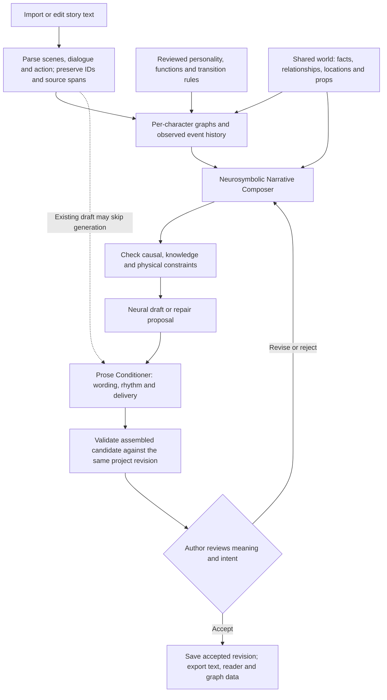

# Text → graphs → composition → prose

The graph describes/constrains the story; the composer proposes events and character reactions; the conditioner improves their written presentation. Neither generated text nor discovered graph rules approve themselves.

In the recovery candidate, the editor invokes explicit stage actions. It does not automatically send the manuscript to a model. `project.analyze` and `workspace.project_report` expose current revision, coverage, diagnostics, observations, and structured reaction proposals. **Draft next beat**, **Repair proposals**, and **Condition prose** use the selected provider and present candidates for review. **Apply reviewed proposal** changes the draft; **Save draft** persists the recoverable revision.

The structured character evaluator currently matches explicit reviewed rules and preconditions. It does not infer a complete personality from arbitrary prose. Character replacement invalidates affected proposals; unrelated facts and identities remain. Missing modeling and unsupported natural-language causes stay visible rather than being silently filled in.

Mechanical checks do not prove preserved meaning or literary quality. The author reviews meaning. Mock-provider exercises qualify data flow and failure handling, not model writing quality. See [recovery evidence](RECOVERY_STATUS.md) and [programming guide](PROGRAMMING_GUIDE.md).
